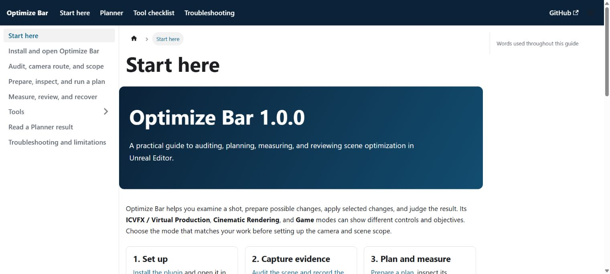

# Optimize Bar documentation

This repository contains an independent Docusaurus site adapted from the supplied **Optimize Bar 1.0.0 User Guide**. It documents the Unreal Engine plugin; it does not contain the plugin distribution or source code.

[Read the published guide](https://rmanmetaverse.github.io/OptimizeBar-Docs/)



## Run locally

Use Node.js 20 or newer:

```bash
npm ci
npm start
```

Run `npm run build` to create the static site in `build/`. Documentation lives in `docs/`, and the four screenshots extracted from the guide live in `static/img/`.

## Publish

The workflow in `.github/workflows/pages.yml` builds and deploys the site when `main` changes. In repository **Settings → Pages**, select **GitHub Actions** as the source. The site URL is `https://rmanmetaverse.github.io/OptimizeBar-Docs/`.

## Source and scope

The source document is `OptimizeBar_User_Guide_1.0.0_Expanded_Review_v3.pdf` (provided by the project owner). The release package metadata was checked against `OptimizeBar_1.0.0_Fab_UE58_TRC_20261122.zip`. The package manifest reports version 1.0.0, Unreal Engine 5.8.0, Win64, Movie Render Pipeline, and Impostor Baker. The package itself remains separate from this public documentation repository. This site has not been validated inside a running Unreal Editor; use the guide's review and recovery procedures when applying changes to a project.

